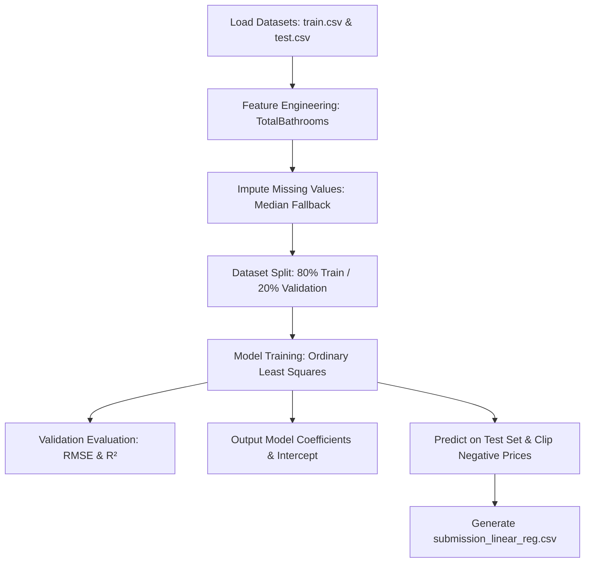

# 🏡 House Price Prediction: Multiple Linear Regression Pipeline

Welcome! This repository contains a production-ready machine learning pipeline for predicting residential house prices. Built during my Machine Learning Internship at **SkillCraft Technology**, this project utilizes a Multiple Linear Regression (Ordinary Least Squares) model to analyze and predict home market values. 

The pipeline is trained on Kaggle's popular **House Prices: Advanced Regression Techniques** dataset, focusing on structural feature representation and model interpretability.

---

## 📌 Project Architecture & Walkthrough

This project is structured as a streamlined, self-contained machine learning pipeline. Here is a walkthrough of the core steps executed in `predict_prices.py`:



### 1. Data Loading & Feature Engineering
Rather than feeding raw, uncurated data to the model, we filter the dataset down to three foundational structural features and engineer a more representative metric:
* **Above-Grade Living Area (`GrLivArea`):** Represents the total square footage of the home above ground level.
* **Bedrooms (`BedroomAbvGr`):** Count of bedrooms above ground.
* **Total Bathrooms (Engineered):** Raw data lists full baths and half baths separately. In real estate, half baths add utility but not as much as full baths. We mathematically engineer a combined capacity feature:
  $$\text{TotalBathrooms} = \text{FullBath} + 0.5 \times \text{HalfBath}$$

### 2. Robust Feature Imputation
Real-world datasets contain missing values. To prevent pipeline execution errors, the `extract_features` helper function handles missing numbers using median imputation based on the training distribution:
```python
features = features.fillna(features.median())
```
*Using the median is a robust approach that protects our model against outliers in the square footage or bathroom counts.*

### 3. Model Training & Evaluation Setup
We use an **80/20 train/validation split** to measure generalization performance before predicting on unseen test data. The model is an OLS (Ordinary Least Squares) Multiple Linear Regression, which finds the line of best fit by minimizing the sum of squared residuals.

---

## 📊 Internship Insights & Model Diagnostics

Executing `predict_prices.py` splits the training data and outputs model weights and validation metrics. Let's analyze the performance and interpret what the model actually learned.

### 1. Validation Performance
* **Root Mean Squared Error (RMSE):** **\$53,371.56**
  * *Interpretation:* On average, our baseline model's predictions deviate by approximately \$53.3k from the actual sale price.
* **Coefficient of Determination ($R^2$ Score):** **0.6286**
  * *Interpretation:* Despite using only **three features**, our model successfully explains **62.86%** of the variance in home sale prices.

### 2. The Learned Regression Formula
The model resolved the following relationship:

$$\text{SalePrice} = \$56,862.58 + (\$100.64 \times \text{GrLivArea}) - (\$26,645.53 \times \text{BedroomAbvGr}) + (\$27,083.21 \times \text{TotalBathrooms})$$

### 3. Deep-Dive: Interpreting the Weights
* **Intercept (Base Price - \$56,862.58):** The starting valuation assumed by the linear model when all features are mathematically zero.
* **Square Footage (`GrLivArea` / +\$100.64 per sq. ft.):** Highly statistically significant. For every additional square foot of above-ground living area, the home price increases by roughly \$100.
* **Total Bathrooms (+\$27,083.21 per bathroom):** Adding a bathroom provides a massive premium to the home value, reflecting buyers' demand for convenience.
* **Bedrooms (`BedroomAbvGr` / -\$26,645.53 per bedroom):**
  > [!NOTE]
  > **The Bedroom Coefficient Paradox**
  > Why is the bedroom weight negative? In multiple regression, coefficients show the effect of adding one unit of a feature *while keeping all other features constant*. 
  > 
  > If you increase the bedroom count but keep the total square footage (`GrLivArea`) the same, you are physically splitting the existing space into smaller, more cramped rooms. In real estate markets, a home with 3 spacious rooms is generally valued higher than the exact same square footage chopped up into 5 tiny rooms. This negative weight beautifully captures that architectural trade-off!

---

## 🛠️ Step-by-Step Execution Guide

Follow these steps to run the pipeline and generate predictions:

### 1. Pre-requisites & Environment Setup
Make sure you have Python 3 installed. Install the necessary libraries using `pip`:
```bash
pip install pandas numpy scikit-learn
```

### 2. Dataset Placement
Download `train.csv` and `test.csv` from Kaggle's House Prices competition and place them in the root of this project directory:
```text
HOUSEPRICEPREDICTION-main/
├── train.csv                 # Kaggle Training dataset (must be present)
├── test.csv                  # Kaggle Test dataset (must be present)
├── predict_prices.py         # ML Pipeline script
└── README.md                 # Documentation
```

### 3. Running the Pipeline
Run the script from your terminal:
```bash
python predict_prices.py
```

### 4. Expected Output
The script will run diagnostics and save the Kaggle submission file:
```text
--- Validation Metrics ---
Root Mean Squared Error (RMSE): $53,371.56
R² Score (Variance Explained): 0.6286

--- Model Parameters ---
Intercept (Base Price): $56,862.58
GrLivArea coefficient: 100.64
BedroomAbvGr coefficient: -26,645.53
TotalBathrooms coefficient: 27,083.21

Submission file 'submission_linear_reg.csv' successfully created!
```

---

## 🚀 Advanced Internship Roadmap: Next Steps to Improve Score

To take this baseline model further and rank higher on the Kaggle leaderboard, an experienced ML engineer should consider:

1. **Log Transformation of the Target:** Home prices are right-skewed. Transforming the target via $y_{new} = \log(\text{SalePrice})$ makes the distribution normal, aligning better with standard regression assumptions.
2. **Handling Outliers:** Plotting `GrLivArea` vs `SalePrice` reveals massive homes sold at unusually low prices. Removing these leverage points stabilizes the regression line.
3. **Adding More Features:** 
   * **Overall Quality (`OverallQual`):** The single strongest predictor in this dataset.
   * **Neighborhood (`Neighborhood`):** Location is critical in real estate; one-hot encoding this variable will capture geographic premiums.
4. **Transition to Tree-Based Regressors:** Switch from Linear Regression to non-linear models like **Random Forests**, **XGBoost**, or **LightGBM** to capture complex feature interactions automatically.
